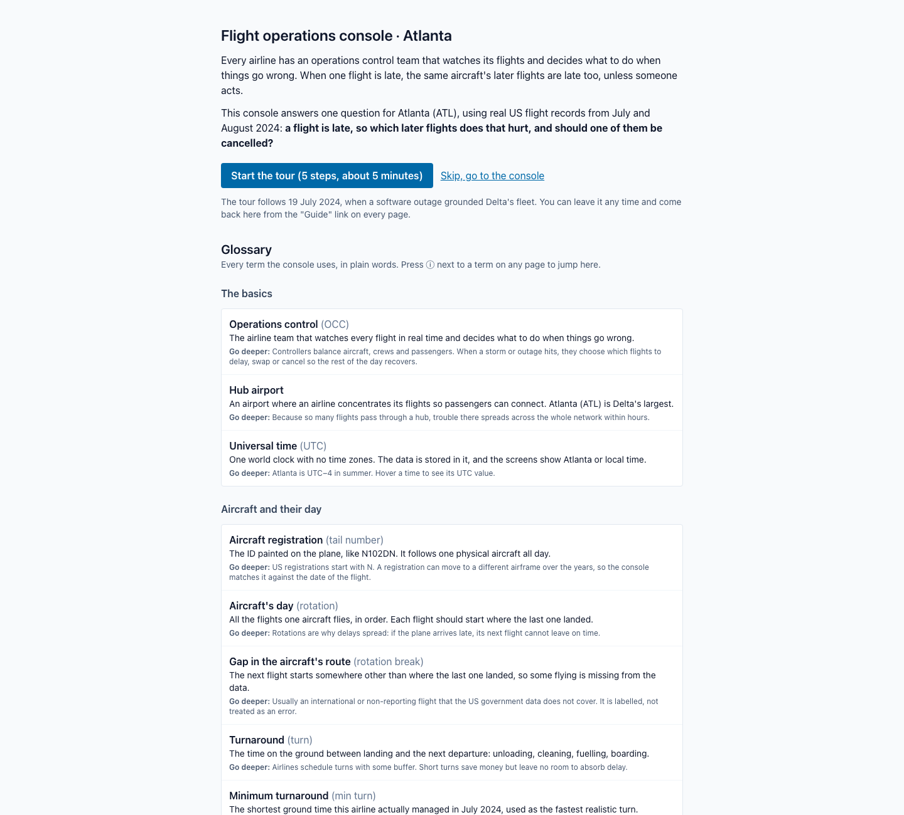
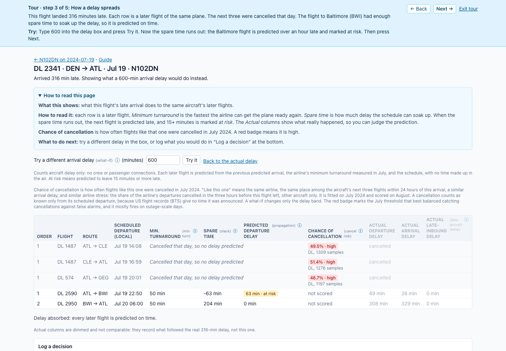
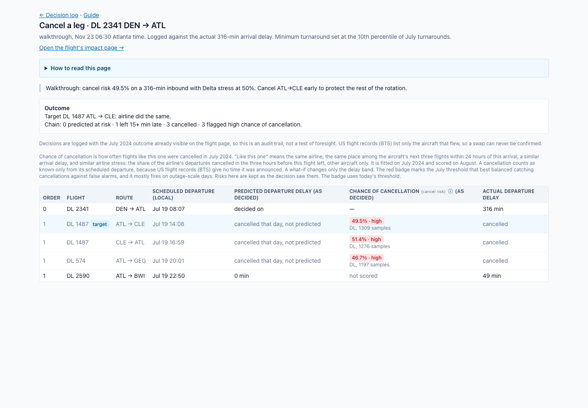
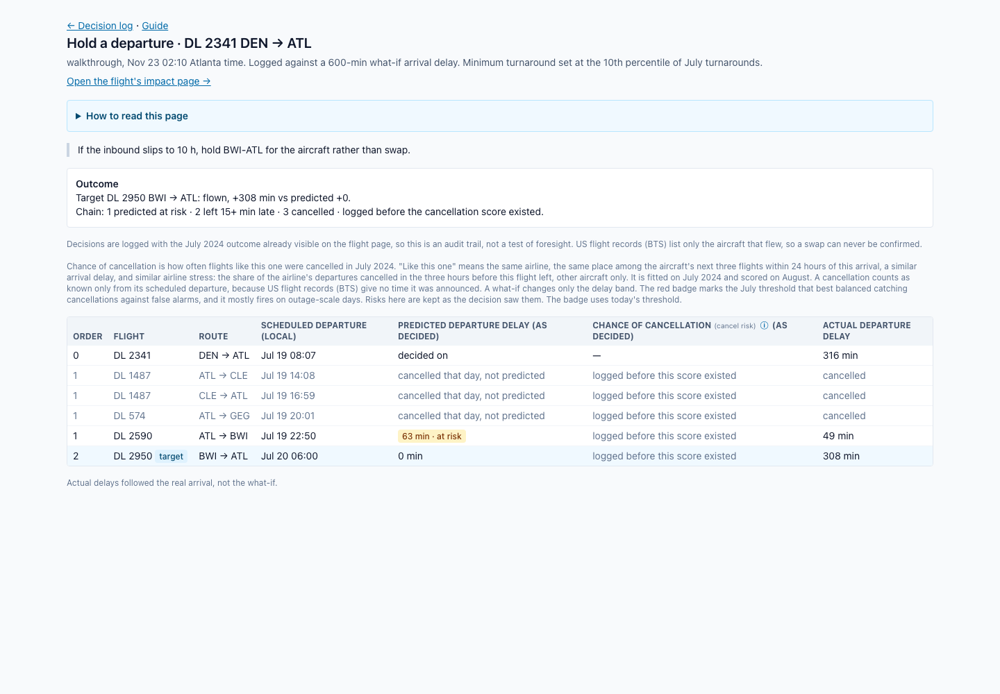
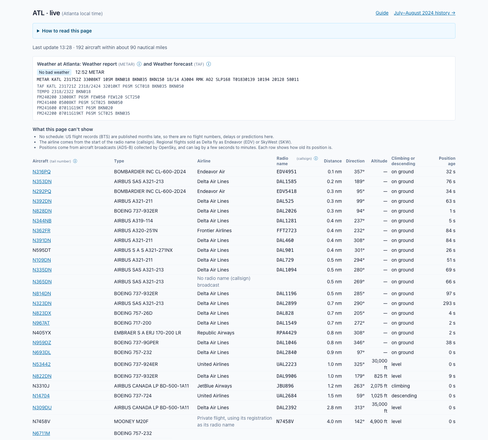

# flight-ops

An airline operations model for one US hub, Atlanta (ATL). It takes messy public aviation data, turns it into a trusted operational model of flights, aircraft and weather, and answers questions an operations controller would ask.

Built so far:

- **A reproducible data foundation** with a data-quality report on July 2024, the month of the CrowdStrike outage, and August 2024 as a holdout.
- **A read-only ops console** that shows what happened at ATL on any day and to any aircraft.
- **Decision support** that shows which later flights a late aircraft puts at risk of delay, and of cancellation. Both models are fitted on July and backtested on August.
- **A decision log** that freezes each prediction with the controller's choice and reviews it against what happened.
- **A live view** of current ATL weather and the aircraft around the airport.

**Start with the [case study](docs/case-study.md)**, which follows an operations controller through the July 19-23 outage.

## What the data shows

From the generated [Phase 1 report](docs/phase-1-report.md):

- **The July 19-23 cancellations at ATL were not weather.** 3,208 flights touching ATL were cancelled; 3,098 carried carrier cause code A and only 30 weather code B. 2,864 were Delta.
- **Weather was mild when it started.** On July 19, 0 of 25 METARs were adverse, yet 895 flights were cancelled.
- **An independent source agrees.** OpenSky ADS-B arrivals for Delta and Endeavor fell by 39-48% on the worst days, against 38-52% in airline-reported BTS data. Daily counts correlate at 0.996 across the month.
- **The model holds together.** Across July and August, 98.94% of consecutive legs on tails that touched ATL connect, and 98.8% of flights with a tail number resolve to a registered airframe. Every unresolved row keeps a reason.

From the generated [Phase 3 report](docs/phase-3-report.md):

- **Delay propagation beats both baselines on the August holdout.** For the first flight after a late arrival, its error in late-aircraft minutes is 13.2, against 46.5 for predicting no delay and 35.6 for carrying the full delay forward. In the July outage, which is inside the fit month, it is 18.4, against 57.9 and 60.0.
- **Its blind spot is cancellation.** During the outage, 9.8% of late arrivals had a cancelled flight on the same aircraft before its next flight, against 1.7% on July's normal days. The delay model shows those flights but doesn't predict them, which is what phase 6 is for.

From the generated [Phase 6 report](docs/phase-6-report.md):

- **Cancellation risk beats both baselines, by a little on normal days.** On August at the first downstream flight, its Brier score is 0.00448, against 0.00475 for delay alone and 0.00498 for the carrier's constant rate, 6% and 10% lower.
- **Carrier stress carries it.** In July, pairs under 2% stress were cancelled 0.67% of the time, and pairs at 10% or more 15.68% of the time. Delay alone can't separate a long delay on a quiet day from one on a bad day.
- **The flag is an outage detector, and the report says so.** It catches 71-74% of cancellations during the outage, but only 2-4% on ordinary days.
- **It catches what delay propagation missed.** After N102DN's 316-minute late arrival on July 19, the delay model flagged nothing. The cancellation model scored its next three legs at 47-51%, and all three were cancelled.

## The ops console

**Start here.** The app opens on a welcome page that explains airline operations control in plain words, with a glossary of every term the console uses. A five-step tour walks through the July 19 outage: the hub's day, one aircraft's day, how its delay spreads, the chance its next flights are cancelled, and logging a decision. Every page also has a "How to read this page" box, and each industry term carries an ⓘ that explains it.






- **Pick a day, see the hub.** Departures and arrivals by local hour, split by status, over a strip of the METARs for the same hours. July 19 is a wall of cancellations under clear skies. July 10 is a normal day with storms.
- **Data problems show where they matter.** Each day lists its caveats (rotation breaks, unresolved or medium-confidence aircraft, stale weather, missing tails), and every flight row carries its own.
- **Drill into an aircraft.** One click opens a tail's legs for the day, plus the legs either side: scheduled and actual bars on an Atlanta-time axis, delay causes, unflown cancellations and labelled gaps where the rotation breaks.


The app reads through a database role that can only select from a schema of views, so the rules for days, statuses and labels live in tested SQL. Its one write is logging a decision, through a single database function.

## Decision support


Open any flown leg, or a late arrival on the hub page, to follow its aircraft's next flights. Each is predicted from the previous arrival, the carrier's minimum turn measured from July, and the schedule. Flights at risk of a 15-minute delay are flagged, the actual delays sit beside the predictions, and a what-if box propagates a different arrival delay. Cancelled flights in the gaps are shown in grey, and every downstream leg gets a cancellation probability from a rate table of carrier, position in the chain, delay bucket and the carrier's stress over the previous three hours.



## Decision log



From any flight's impact page, a controller can log a decision (accept the delay, hold a departure, swap aircraft, cancel a leg) with a reason. The predicted chain is frozen with it. The log puts each decision next to what BTS shows happened: whether the airline cancelled the target leg, and how late it actually left against the frozen prediction. The log is append-only and survives a rebuild of the data, re-matching each flight on carrier, flight number, origin and scheduled departure. Decisions are made with the July outcome already visible, so this is an audit trail, not a test of foresight.

## Live view



The one page about the present. A poller (`python -m flightops live`) fetches current weather from aviationweather.gov and the aircraft in the air or on the ground around ATL from OpenSky every 60 seconds, and resolves each aircraft to a tail, type and operator through the FAA registry. BTS is published months late, so there is no live schedule, and the page shows no delays or predictions. When the poller stops, the page flags the data as stale.

## How it works

```
BTS on-time data ─┐
FAA registry ─────┼─> raw ─> staging ─> ontology ─> report / app
IEM METAR + TAF ──┤          (checks)   flights, aircraft,
OpenSky ADS-B ────┘                     rotations, weather
```

- **raw:** idempotent loads, each file recorded with its SHA-256. Bad rows go to quarantine, not the floor.
- **staging:** typed and cleaned. Times normalised to UTC.
- **ontology:** flights, airframes, rotations and the weather at each departure and arrival, plus each carrier's measured minimum turn and the propagation backtest. Promotion is blocked if a data-quality check fails.
- **reports:** generated from the database, with the SQL for each table beside it.

Scale: 1,253,638 flights across July and August 2024 (the national file, so rotations don't break when an aircraft leaves ATL), 119,106 touching ATL, 7,529 airframes and 1,812 ATL METARs.

Trade-offs are logged in [DECISIONS.md](DECISIONS.md), and the plan for later phases is in [docs/roadmap.md](docs/roadmap.md): a second hub and containers.

## Stack

Python (uv, pytest), PostgreSQL and SQL for the pipelines. Laravel 13, Inertia and Vue for the app, tested with Pest and `node --test`.

## Run it

Needs PostgreSQL running locally and [uv](https://docs.astral.sh/uv/).

```sh
cp .env.example .env          # set the database connection
cd pipelines
uv run --env-file ../.env python -m flightops all      # migrate, fetch, load, build, report
uv run --env-file ../.env pytest
```

Downloaded source files land in `data/`, which is not committed.

To run the app once the pipeline has built the database:

```sh
cd web
composer install && npm install
cp .env.example .env && php artisan key:generate
npm run build
php artisan serve      # http://127.0.0.1:8000 opens the welcome page and tour
./vendor/bin/pest      # tests run against the loaded database
```

The app connects as `flightops_app`, a read-only role the migrations create without a password. That assumes local trust authentication, as Postgres.app sets up by default.

## Data sources

[BTS Reporting Carrier On-Time Performance](https://www.transtats.bts.gov/), [FAA aircraft registry](https://www.faa.gov/licenses_certificates/aircraft_certification/aircraft_registry/releasable_aircraft_download), [Iowa Environmental Mesonet](https://mesonet.agron.iastate.edu/) and [The OpenSky Network](https://opensky-network.org). Citations are in the report.
