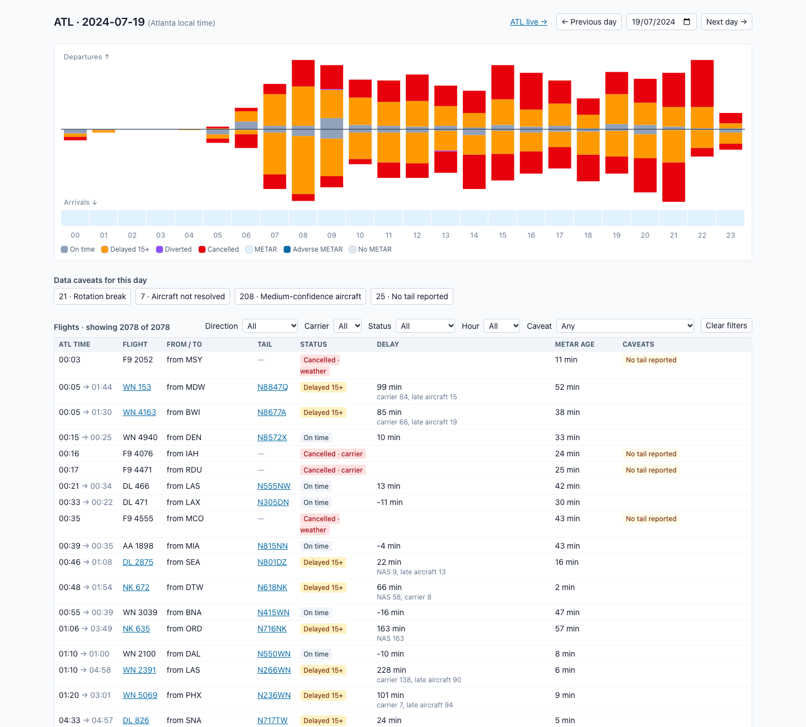
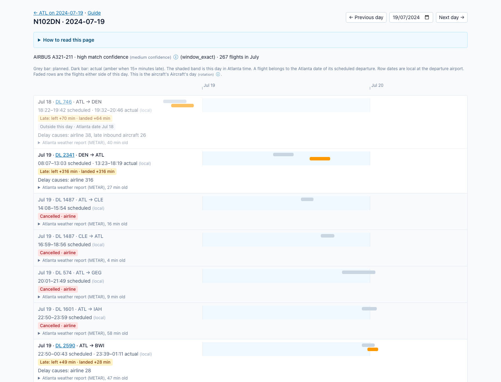
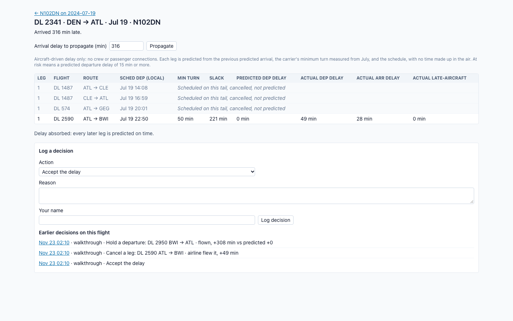

# flight-ops

An airline operations model for one US hub, Atlanta (ATL). It takes messy public aviation data, turns it into a trusted operational model of flights, aircraft and weather, and answers questions an operations controller would ask.

Phases 1-3 are built: a reproducible data foundation with a data-quality report on July 2024, the month of the CrowdStrike outage; a read-only ops console that shows what happened at ATL on any day and to any aircraft; and decision support that shows which later flights a late aircraft puts at risk, backtested on the whole month.

**Start with the [case study](docs/case-study.md)**, which follows an operations controller through the July 19-23 outage.

## What the data shows

From the generated [Phase 1 report](docs/phase-1-report.md):

- **The July 19-23 cancellations at ATL were not weather.** 3,208 flights touching ATL were cancelled; 3,098 carried carrier cause code A and only 30 weather code B. 2,864 were Delta.
- **Weather was mild when it started.** On July 19, 0 of 25 METARs were adverse, yet 895 flights were cancelled.
- **An independent source agrees.** OpenSky ADS-B arrivals for Delta and Endeavor fell by 39-48% on the worst days, against 38-52% in airline-reported BTS data. Daily counts correlate at 0.996 across the month.
- **The model holds together.** 98.70% of consecutive aircraft legs connect, and 98.8% of flights with a tail number resolve to a registered airframe. Every unresolved row keeps a reason.

From the generated [Phase 3 report](docs/phase-3-report.md):

- **Delay propagation beats both baselines.** For the first flight after a late arrival, its error in late-aircraft minutes is 13.0 on normal days, against 48.4 for predicting no delay and 36.1 for carrying the full delay forward. On the held-out outage days it is 18.4, against 57.9 and 60.0.
- **Its blind spot is cancellation.** During the outage, 9.8% of late arrivals had a cancelled flight on the same aircraft before its next flight, against 1.6% on normal days. The model shows those flights but doesn't predict them.

## The ops console



- **Pick a day, see the hub.** Departures and arrivals by local hour, split by status, over a strip of the METARs for the same hours. July 19 is a wall of cancellations under clear skies. July 10 is a normal day with storms.
- **Data problems show where they matter.** Each day lists its caveats (rotation breaks, unresolved or medium-confidence aircraft, stale weather, missing tails), and every flight row carries its own.
- **Drill into an aircraft.** One click opens a tail's legs for the day, plus the legs either side: scheduled and actual bars on an Atlanta-time axis, delay causes, unflown cancellations and labelled gaps where the rotation breaks.



The app reads through a database role that can only select from a schema of views, so the rules for days, statuses and labels live in tested SQL, and the app cannot write.

## Decision support



Open any flown leg, or a late arrival on the hub page, to follow its aircraft's next flights. Each is predicted from the previous arrival, the carrier's minimum turn measured from July, and the schedule. Flights at risk of a 15-minute delay are flagged, the actual delays sit beside the predictions, and a what-if box propagates a different arrival delay. Cancelled flights in the gaps are shown in grey and never predicted.

## How it works

```
BTS on-time data ─┐
FAA registry ─────┼─> raw ─> staging ─> ontology ─> report / app
IEM METAR + TAF ──┤          (checks)   flights, aircraft,
OpenSky ADS-B ────┘                     rotations, weather
```

- **raw:** idempotent loads, each file recorded with its SHA-256. Bad rows go to quarantine, not the floor.
- **staging:** typed and cleaned. Times normalised to UTC.
- **ontology:** flights, airframes, rotations and the weather at each departure and arrival, plus each carrier's measured minimum turn and the propagation backtest. Promotion is blocked if a data-quality check fails.
- **reports:** generated from the database, with the SQL for each table beside it.

Scale: 634,613 flights for the month (the national file, so rotations don't break when an aircraft leaves ATL), 60,144 touching ATL, 7,280 airframes, 10,496 METARs.

Trade-offs are logged in [DECISIONS.md](DECISIONS.md), and the plan for later phases is in [docs/roadmap.md](docs/roadmap.md): live data, operator decisions, a second hub and containers.

## Stack

Python (uv, pytest), PostgreSQL and SQL for the pipelines. Laravel 13, Inertia and Vue for the app, tested with Pest and `node --test`.

## Run it

Needs PostgreSQL running locally and [uv](https://docs.astral.sh/uv/).

```sh
cp .env.example .env          # set the database connection
cd pipelines
uv run --env-file ../.env python -m flightops all      # migrate, fetch, load, build, report
uv run --env-file ../.env pytest
```

Downloaded source files land in `data/`, which is not committed.

To run the app once the pipeline has built the database:

```sh
cd web
composer install && npm install
cp .env.example .env && php artisan key:generate
npm run build
php artisan serve      # http://127.0.0.1:8000
./vendor/bin/pest      # tests run against the loaded database
```

The app connects as `flightops_app`, a read-only role the migrations create without a password. That assumes local trust authentication, as Postgres.app sets up by default.

## Data sources

[BTS Reporting Carrier On-Time Performance](https://www.transtats.bts.gov/), [FAA aircraft registry](https://www.faa.gov/licenses_certificates/aircraft_certification/aircraft_registry/releasable_aircraft_download), [Iowa Environmental Mesonet](https://mesonet.agron.iastate.edu/) and [The OpenSky Network](https://opensky-network.org). Citations are in the report.
