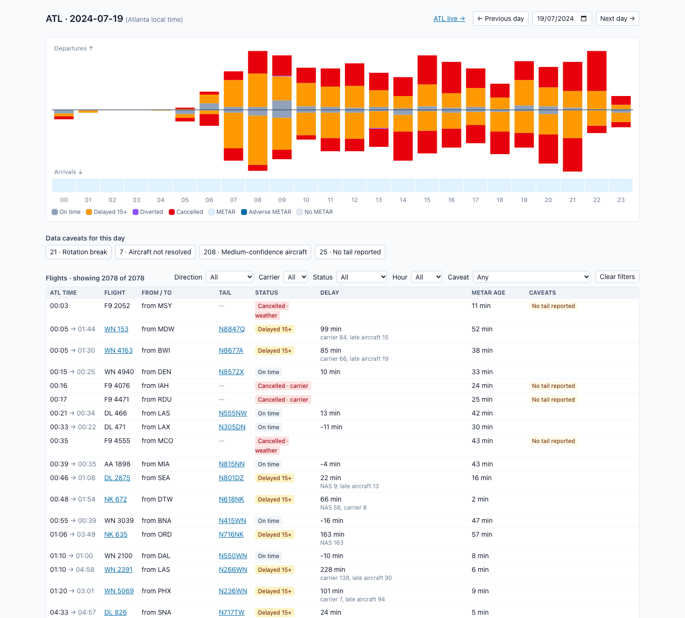
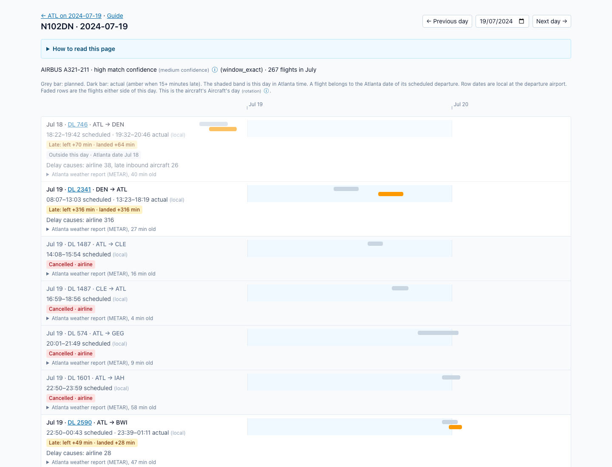
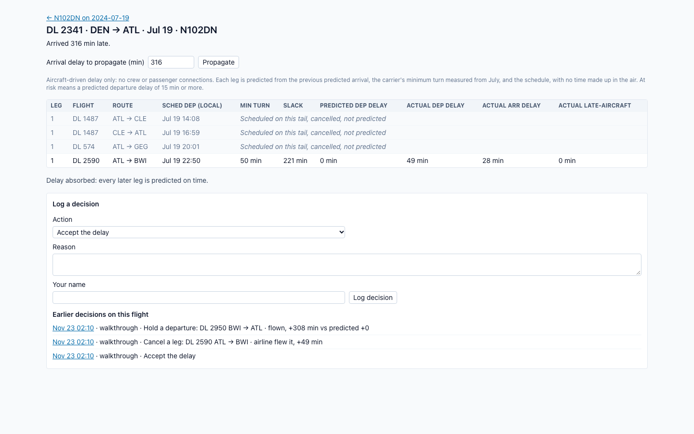

# The July 2024 outage at ATL: a case study

It is Friday, July 19, 2024, and you are running operations at Atlanta. The skies are clear, yet the cancellations keep coming. By the end of the ATL day, 899 of the hub's 2,078 scheduled flights will be cancelled.[^hub] You need three answers, in order. Can I trust what my data is telling me? What is actually happening? And if an aircraft is running late, what breaks next?

This project answers those questions from public data only: BTS on-time records, the FAA aircraft registry, Iowa Environmental Mesonet weather and OpenSky ADS-B tracks. July 19-23 is the period of the CrowdStrike outage. BTS doesn't name a cause, so everything below is what the data shows, not why it happened.

## Can I trust this data?

The four sources don't agree on how to name things. BTS identifies airports by IATA code and weather uses ICAO. Tail numbers arrive with and without the `N`. A tail can be re-registered to a different airframe, so the registry has to be read against the flight date rather than today. Before any of it could answer a question, it had to become one model of airports, carriers, airframes, flights and weather, with every unresolved match recorded with a reason instead of dropped.

The first decision was scope. An ATL extract would have been ten times smaller, but it only contains legs touching ATL, so every aircraft would look as if it teleported whenever it flew elsewhere. The pipeline [loads the national file](../DECISIONS.md#2026-11-01-load-the-national-bts-file-not-an-atl-extract) (634,613 flights) and then filters to the 60,144 that touch ATL. That choice is what makes aircraft rotations, and everything in phase 3, possible.

The model is checked, not assumed. Promotion stops if a blocking data-quality check fails, and the [phase 1 report](phase-1-report.md#findings) shows the results:

- **Rotations hold together.** Across July and August, 98.94% of consecutive legs on tails that touched ATL connect: the next origin is where the aircraft last landed. The rest carry a label for the likely cause, such as unreported flying or a diversion.
- **Aircraft resolve.** 98.8% of flights with a tail number link to an airframe. 14,396 stay unresolved, each with a reason.
- **Reported causes match observed weather.** An adverse METAR fell inside the delay window for 77.0% of ATL departures that BTS blamed on weather, against 19.1% of other delayed departures.

The strongest check is an independent witness. BTS is what airlines report, and OpenSky is what ground receivers saw. Against the same weekday a week earlier, Delta and Endeavor arrivals at ATL [fell by 38-52% in BTS and 39-48% in OpenSky](phase-1-report.md#opensky-against-bts-july-15-27) on July 19-21, and across the month the two sources' daily counts [correlate at 0.996](phase-1-report.md#opensky-and-bts-agreement-july-2-31). The airline data isn't flattering itself.

## What happened?

From July 19 to 23, [3,208 flights touching ATL were cancelled](phase-1-report.md#findings). 3,098 carried cancellation code A (carrier) and 30 carried code B (weather), and 2,864 were Delta. On July 19, [0 of 25 METARs at ATL were adverse](phase-1-report.md#atl-by-day-july-15-27), while 895 flights with a July 19 flight date were cancelled. (The 899 above counts by the ATL day of each flight's Atlanta event, as the hub page does, so an overnight arrival lands on the day it reaches Atlanta.)

The hub view makes the pattern hard to miss: a wall of cancellations over a strip of METARs with nothing adverse in it. July 10, for comparison, has real storms and an ordinary day.

One aircraft makes it concrete. [N102DN](phase-1-report.md#one-aircraft-july-18-23), an A321, flew a normal July 18. On July 19 its Denver to Atlanta leg left 5 hours 16 minutes late, and from then until July 23, 11 of its legs were cancelled, all with code A. Every leg it did fly connected to the one before. The aircraft was exactly where the data says, while the schedule around it fell away.

This page is where a real modelling decision showed up. The first version ordered a tail's legs by actual time, and used scheduled time for cancelled legs, which have no actual. On N102DN that put the cancelled ATL→CLE *before* the late DEN→ATL that should have fed it, so the aircraft appeared to leave Atlanta before it arrived. The page now [orders legs by schedule](../DECISIONS.md#2026-11-22-order-a-tails-legs-by-scheduled-departure). That puts 9,534 flown legs under a different row than the leg they actually followed, so whether a leg connects is still computed from the order the aircraft actually flew. Display order and analytical order are kept apart on purpose.

## What breaks next?

Select a late arrival, and the FlightImpact page follows that aircraft's next flights. Each downstream departure can leave no earlier than the previous predicted arrival plus the carrier's minimum turn. Any shortfall against the schedule becomes predicted delay, and no time is made up in the air. A leg is at risk when its predicted departure delay reaches 15 minutes, the BTS on-time threshold.

The minimum turn is measured, not assumed. It comes from July turns where the next leg reported a `late_aircraft` delay, so the aircraft was the constraint. Carriers differ: [at the 10th percentile](phase-3-report.md#min-turn), Delta turns in 50 minutes and PSA (`OH`) in 28. One constant would be wrong for most of them.

The model was then backtested on every late arrival in July and August on tails that touched ATL, [117,818 legs](phase-3-report.md#what-the-model-misses) in July alone, each scored against up to its next three flights. Pairs come from the aircraft's flown chain rather than from the model's own output, so legs the model called "absorbed" are still scored, which is where it can be wrong. The turn percentile was [chosen on July's normal days](phase-3-report.md#percentile-choice) (p10, with error 13.0 minutes, against 13.2 at p5, 14.7 at p25 and 20.4 at p50). August scores it, and neither the turns nor the choice saw August.

The model beats both obvious baselines, predicting no delay and carrying the full delay forward, [at every depth, for both targets, in every period](phase-3-report.md#late-aircraft-minutes-against-baselines). At the first downstream flight:

| Late-aircraft minutes, mean absolute error | Model | Predict 0 | Full carry |
|---|---|---|---|
| July normal days, fitted | 13.0 | 48.3 | 36.4 |
| August, held out | 13.2 | 46.5 | 35.6 |
| Debby, Aug 2-6, held out | 13.8 | 49.4 | 43.4 |
| July outage | 18.4 | 57.9 | 60.0 |

When it flags a first downstream flight at risk in August, it is right 89.6% of the time, against a 74.6% base rate, and it flags 89.1% of the flights that were. By the third flight its recall drops to 31.1%: delay that comes back later in the day was usually caused by something else.

Back to N102DN. Its DEN→ATL arrived 316 minutes late, and the next leg it flew, ATL→BWI, wasn't scheduled until 22:50 that evening. The model gives it a 50-minute turn and 221 minutes of slack, and [calls the delay absorbed](phase-3-report.md#worked-example-n102dn-july-19). That was right as far as it goes. ATL→BWI left 49 minutes late with zero minutes blamed on late aircraft. The leg after it, BWI→ATL, [left 308 minutes late](phase-3-report.md#worked-example-n102dns-scored-pairs), also with zero late-aircraft minutes: outage disruption that had nothing to do with this aircraft's arrival.

## What the model can't see

The grey rows in that screenshot matter more than the numbers. Between the late arrival and ATL→BWI, three flights were scheduled on this aircraft (ATL→CLE, CLE→ATL and ATL→GEG), and all three were cancelled. The model shows them but predicts nothing for them.

That isn't an edge case. On normal July days, [1.7% of late arrivals](phase-3-report.md#what-the-model-misses) (1,501 of 90,768) had a cancelled flight in the gap before the aircraft's next flight. During the outage it was 9.8% (2,660 of 27,050), almost six times as often. Debby, a milder weather disruption in early August, sits between them at 6.7%. In the outage, the decision that mattered was often not "how late will the next flight be" but "which flights do we cancel", and the model only scores the flying that survived.

The other limits are stated in the [phase 3 report](phase-3-report.md#limits):

- **Aircraft only.** BTS has no crew or passenger connections. The model undercounts departure delay by [13.7 minutes in August, 17.4 on normal July days and 33.8 in the outage](phase-3-report.md#departure-delay-against-baselines), the gap that other causes fill.
- **Fit on July, scored on August.** The turns and the percentile come from July and are scored on August, where the first-leg error is 13.2 minutes against 13.0 in sample. Debby (Aug 2-6) is a second, [milder disruption](../DECISIONS.md#2026-11-23-treat-august-2-6-as-a-separate-period-debby): at worst 6.8% of ATL flights were cancelled, against 43% on July 19. The outage is inside the fit month, so its scores are not out of sample.
- **Shorter turns score worse.** p5 was tested and scored 13.2 minutes on July's normal days, against 13.0 at p10, even though p10 still overpredicts the first leg by 5.0 minutes on average.
- **Hindsight in the chain.** The model follows the order the aircraft actually flew, which a controller wouldn't know in advance. It matters little here: [248 of 190,834](phase-3-report.md#what-the-model-misses) scored pairs in August involve a swap.

## What I'd do next

1. **A second month, done.** Turns and the percentile are now [fitted on July and scored on August](../DECISIONS.md#2026-11-23-choose-the-min-turn-percentile-on-july-and-score-it-on-august), 13.2 minutes against 13.0 in sample, with Debby as a second, milder disruption.
2. **Model cancellation risk, in progress.** The outage shows that the high-stakes decision is often cancellation, and the data already carries cause codes, scheduled flying and the gaps where flights disappear. This is the current phase, fitted on July and scored on August.
3. **Then go live.** Current weather and positions (phase 4) are worth more once the model answers the question that matters during a bad day.

The pattern behind all of this is the same: check the data before trusting it, keep the cases where it disagrees with itself visible, and when the model can't see something, put it on screen anyway with a label instead of leaving it out.

[^hub]: Counted by the ATL local day of each flight's scheduled Atlanta event, as the hub page files flights: `select sum(scheduled), sum(cancelled) from app_read.hub_day_hourly where atl_day = '2024-07-19'` returns 2078 and 899.
